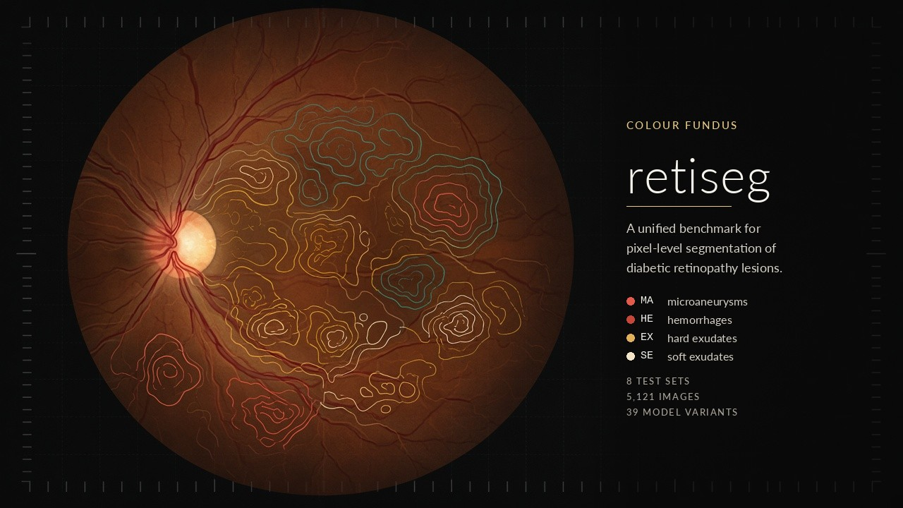
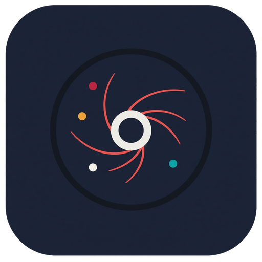

<p align="center">
  
</p>

<p align="center">
  <a href="https://github.com/skylynf/retiseg/actions/workflows/tests.yml"></a>
  <a href="https://www.python.org/"></a>
  <a href="https://pytorch.org/"></a>
  
</p>

A unified benchmark for pixel-level segmentation of diabetic retinopathy lesions in colour fundus photographs: microaneurysms (MA), hemorrhages (HE), hard exudates (EX) and soft exudates / cotton-wool spots (SE).

One protocol covers data preparation, frozen splits, training amount, augmentation, checkpoint selection, inference geometry and evaluation, so that general segmentation networks, the self-configuring nnU-Net, fundus-specific networks and adapted segmentation foundation models can be compared on the same images with the same metric, inside the training source and on independent sources that were never used for training.

## Contents

<table>
  <tr>
    <td align="center" width="12.5%"><a href="#what-is-in-the-benchmark"><br><b>Benchmark</b></a></td>
    <td align="center" width="12.5%"><a href="#repository-layout"><br><b>Layout</b></a></td>
    <td align="center" width="12.5%"><a href="#setup"><br><b>Setup</b></a></td>
    <td align="center" width="12.5%"><a href="#data"><br><b>Data</b></a></td>
    <td align="center" width="12.5%"><a href="#training-and-evaluation"><br><b>Training</b></a></td>
    <td align="center" width="12.5%"><a href="#tests"><br><b>Tests</b></a></td>
    <td align="center" width="12.5%"><a href="#documentation"><br><b>Docs</b></a></td>
    <td align="center" width="12.5%"><a href="#licence"><br><b>Licence</b></a></td>
  </tr>
</table>

## What is in the benchmark

<table>
  <tr>
    <td align="center" width="25%"><b>8</b><br><sub>test sets</sub></td>
    <td align="center" width="25%"><b>5,121</b><br><sub>images</sub></td>
    <td align="center" width="25%"><b>39</b><br><sub>registered variants</sub></td>
    <td align="center" width="25%"><b>19</b><br><sub>comparison rows</sub></td>
  </tr>
</table>

| | |
|---|---|
| Training sources | IDRiD (official split, 10 training images held out for validation), DDR (official split) |
| Independent test sets | TJDR standard field, TJDR ultra-widefield, MAPLES-DR, FGADR, Retinal-Lesions, DiaRetDB1 — inference only (eight test sets, 5,121 images in all), with frozen split lists and a near-duplicate audit between every source |
| Models | 39 registered variants in five families (general, self-configuring, fundus-specific, relational/transformer, foundation models), each with a reproducibility level (R0–R4) and an evaluation track; 19 rows in the unified comparison |
| Evaluations | authors' released weights, authors' recipes rerun, unified retraining (B-std), source recipes (B1), foundation models in four kinds of use (zero-shot, oracle prompts, parameter-efficient fine-tuning, encoder + decoder) |
| Factors | training source, annotation granularity, input resolution, training amount, loss, lesion size — one at a time on representative models |
| Metric | exact pooled AUPR per lesion class inside the field of view (mAUPR over the four classes); Dice/IoU at fixed and validation-chosen thresholds; lesion-level recall by lesion size; image-level ROC for DiaRetDB1 |

Every model writes one 16-bit probability map per image at the original resolution; all metrics are computed offline from these maps by a single evaluation module.

## Repository layout

<table>
  <tr>
    <td width="78" align="center"></td>
    <td>The protocol, the model wrappers and the records are in git. Images, training runs and weights are not. Authors' code is pinned in <a href="official_code"><code>official_code/</code></a> and is never modified.</td>
  </tr>
</table>

<br>

<table>
  <tr>
    <td colspan="4"> &nbsp; <b><a href="bench">bench/</a></b> &nbsp; <sub>the benchmark</sub></td>
  </tr>
  <tr>
    <td align="center" width="25%"><a href="bench/data"></a><br><b><a href="bench/data">data/</a></b><br><sub>Readers, FOV masks,<br>canvas cache, frozen splits</sub></td>
    <td align="center" width="25%"><a href="bench/models"></a><br><b><a href="bench/models">models/</a></b><br><sub>One wrapper per model,<br>and the author recipe</sub></td>
    <td align="center" width="25%"><a href="bench/configs"></a><br><b><a href="bench/configs">configs/</a></b><br><sub>Registry, frozen protocols,<br>job tables, one YAML per run</sub></td>
    <td align="center" width="25%"><a href="bench/eval"></a><br><b><a href="bench/eval">eval/</a></b><br><sub>Pixel, lesion-level and<br>image-level metrics</sub></td>
  </tr>
  <tr>
    <td align="center"><a href="bench/e5"></a><br><b><a href="bench/e5">e5/</a></b><br><sub>Foundation-model tiers:<br>masks, text, oracle prompts</sub></td>
    <td align="center"><a href="bench/scripts"></a><br><b><a href="bench/scripts">scripts/</a></b><br><sub>Launchers, export,<br>leak audit, handoff</sub></td>
    <td align="center"><a href="bench/tests"></a><br><b><a href="bench/tests">tests/</a></b><br><sub>pytest, on CPU,<br>on every push</sub></td>
    <td align="center"><a href="bench/train.py"></a><br><b><a href="bench/train.py">train.py</a></b><br><sub><a href="bench/bstd.py">bstd.py</a> · <a href="bench/factor.py">factor.py</a><br><a href="bench/e3a.py">e3a.py</a> — retrain, factors, tests</sub></td>
  </tr>
</table>

<br>

<table>
  <tr>
    <td colspan="4"> &nbsp; <b>Code and records</b></td>
  </tr>
  <tr>
    <td align="center" width="25%"><a href="official_code"></a><br><b><a href="official_code">official_code/</a></b><br><sub>34 pinned submodules,<br>never modified</sub></td>
    <td align="center" width="25%"><a href="reproductions"></a><br><b><a href="reproductions">reproductions/</a></b><br><sub>CLC-Net and TC-Net,<br>where no code was released</sub></td>
    <td align="center" width="25%"><a href="literature"></a><br><b><a href="literature">literature/</a></b><br><sub>Ledger, search, screening,<br>extracted reported numbers</sub></td>
    <td align="center" width="25%"><a href="docs"></a><br><b><a href="docs">docs/</a></b><br><sub>Design, operations, writing.<br>Index in <a href="docs/README.txt">docs/README.txt</a></sub></td>
  </tr>
</table>

<br>

<table>
  <tr>
    <td colspan="3"> &nbsp; <b>Kept off git</b></td>
  </tr>
  <tr>
    <td align="center" width="33%"><br><b>dataset/</b><br><sub>Original releases and<br><code>dataset/prepared/</code></sub></td>
    <td align="center" width="33%"><br><b>runs/</b><br><sub>Training outputs,<br>maps and metrics</sub></td>
    <td align="center" width="34%"><br><b>pretrained/</b><br><sub>ImageNet backbones and<br>foundation-model weights</sub></td>
  </tr>
</table>

The datasets have to be obtained from their authors. Some licences (FGADR, Retinal-Lesions) forbid redistribution of images, masks or derived data, so only split lists and code are published for them.

<details>
<summary>Plain tree</summary>

```text
bench/                  the benchmark
  data/                 readers for each release, FOV masks, canvas cache, frozen split lists (data/splits/)
  models/               one wrapper per model: builds the network from official_code/ or reproductions/, declares the author recipe
  configs/              models.yaml (registry), *_frozen.yaml (protocol, append-only), job tables, cells/ (one YAML per run)
  eval/                 the evaluation module (protocol.yaml, pixel, lesion-level and image-level metrics, statistics)
  e5/                   foundation-model inference tiers (automatic masks, text prompts, oracle prompts)
  scripts/              launchers, server stages, data export, leak audit, cost audit, handoff packaging
  tests/                pytest suite (CPU; runs in GitHub Actions on every push)
  train.py, bstd.py     unified retraining (B-std) and source-recipe (B1) runner
  factor.py             factor experiments (E3b, E4, E7, E8, E9)
  e3a.py                independent tests of every scored checkpoint
official_code/          authors' repositories as git submodules, pinned to a commit; never modified
reproductions/          re-implementations from the paper where no code was released (with their assumption lists)
literature/             the literature ledger, search and screening records, extracted reported numbers
docs/                   project notes in Chinese (design, operations log, writing); docs/README.txt is the index
```

</details>

## Setup

```bash
git clone git@github.com:skylynf/retiseg.git
cd retiseg
git submodule update --init --depth 1     # authors' code; see below for a smaller set
```

`official_code/DeepLabv3plus` is the whole `tensorflow/models` repository and is not needed to run anything (the DeepLabv3 baseline uses torchvision). To save disk, initialise only the submodules you need, e.g.

```bash
git submodule update --init --depth 1 -- official_code/M2MRF official_code/HACDR-Net \
  official_code/HRNet-Semantic-Segmentation official_code/Swin-Unet official_code/FCT official_code/H2Former
```

Environments are created by `bash bench/scripts/cluster_env.sh all` (micromamba, mamba or conda):

- `retiseg` — Python 3.11, PyTorch 2.x (CUDA 12.4 wheels by default; `RETISEG_TORCH_INDEX` overrides), `bench/requirements-train.txt`; runs most models, M2MRF through a small mmcv compatibility layer.
- `retiseg-hacdr` — Python 3.8, PyTorch 1.10, mmcv-full 1.6.2; runs HACDR-Net and HRDecoder (their mmseg forks).
- `retiseg-sam3` — Python 3.12, PyTorch ≥ 2.7; the SAM 3 text-prompt tier.
- evaluation only: `pip install -r bench/requirements-eval.txt`.

Pretrained weights are listed, not downloaded, by the script; put them under `pretrained/` (ImageNet backbones: file names and URLs in `bench/pretrained.py`; foundation-model checkpoints: names and SHA-256 in `bench/configs/e5_frozen.yaml`). A run refuses to start when a weight its recipe names is absent.

## Data

Place each release under `dataset/` as described in `bench/data/*.py` (most readers open the archives directly). Then export the unified layout — original-resolution RGB, one binary mask per class, a field-of-view mask, `splits.json`, extended labels and ignore regions where the source has them:

```bash
python bench/scripts/prepare_datasets.py export TJDR          # also FGADR, Retinal-Lesions, DiaRetDB1, MAPLES-DR
python bench/scripts/prepare_datasets.py report TJDR_std
python -m bench.data.canvas_cache --data dataset/prepared/IDRiD --diameter 1440   # training canvas cache
```

Split lists for the sources without an official split are committed in `bench/data/splits/` and are drawn once (`prepare_datasets.py splits ...` refuses a different draw). `bench/scripts/leak_audit.py` finds near-duplicate images between sources and splits; the exclusions it produced are in `bench/data/splits/leak_exclusions.json` and are applied automatically when a source is both trained and tested on.

## Training and evaluation

Each run is one YAML cell under `bench/configs/cells/` and one directory under `runs/` with the config, seed, commit, environment, recipe (actual settings and every deviation from the author recipe), validation history, probability maps and metrics.

```bash
# one unified-retraining run (B-std): train, select the checkpoint on validation mAUPR, predict, evaluate
python bench/train.py --config bench/configs/cells/bs_hrnet_ddr_seed0.yaml --resume

# evaluate any directory of probability maps under the frozen protocol
python -m bench.eval.cli evaluate --data dataset/prepared/DDR --split test \
    --pred runs/BS_hrnet_ddr_seed0/prob_test --val-pred runs/BS_hrnet_ddr_seed0/prob_val \
    --out runs/BS_hrnet_ddr_seed0/metrics_test

# independent tests of a scored checkpoint on every test set
python -m bench.e3a run --run runs/BS_hrnet_ddr_seed0

# the job tables and the one queue used on the cluster
python bench/scripts/launch_b1.py --jobs bench/configs/bs_jobs.yaml          # print the B-std table
RETISEG_GPUS="2 3 4 5 6 7" bash bench/scripts/server_run.sh queue            # bench/configs/queue.yaml
```

`bench/scripts/server_run.sh` lists every stage (environments, checks, smoke runs, budget probes, nnU-Net bridge, factor cells, foundation-model inference tiers, status and curves). `python bench/scripts/run_status.py status` summarises `runs/`.

The protocol files (`bench/eval/protocol.yaml`, `bench/configs/bs_frozen.yaml`, `b1_frozen.yaml`, `e3a_frozen.yaml`, `e5_frozen.yaml`) were frozen before the corresponding test sets were read and are append-only; recipe revisions are recorded in `bs_frozen.yaml` and in each run's `recipe.json`.

## Tests

```bash
python -m pytest bench/tests -q
```

Tests that need datasets, weights or a particular environment skip when those are absent; `.github/workflows/tests.yml` runs the suite with CPU torch on every push.

## Documentation

`docs/README.txt` indexes the project notes (design, operations log, writing). They are kept in Chinese and record every decision, protocol change and result with its date and commit.

## Licence

The code in `bench/`, `reproductions/` and `docs/` is released under the licence in `LICENSE` (to be added). Each submodule in `official_code/` keeps its own licence. The datasets are subject to their own terms.
